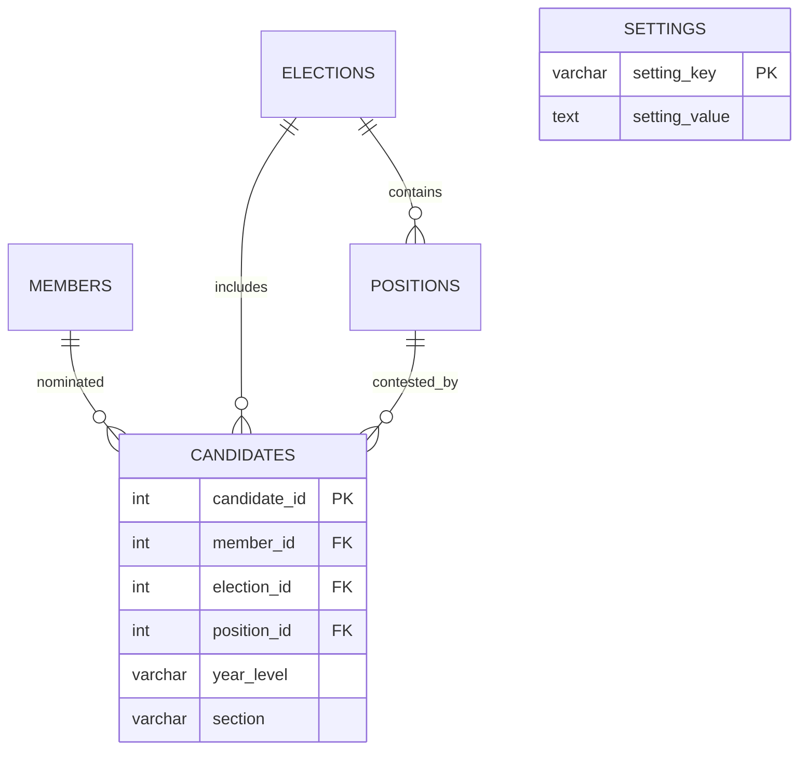

# Candidate academic details

Updated 10 November 2026.

Candidate Management uses one **Year & Section** group with separate Year and
Section inputs. Department and Course no longer appear in the candidate form,
cards, list, profile, or CSV export. Their existing database values remain for
historical compatibility; this update does not delete them.

Age is no longer shown or returned for candidates. The live database and current
schema have no separate age column; voter date of birth remains for registration.
Profile pictures now come from the linked member, regardless of which election
is selected. See `SHARED_PROFILE_PHOTO_REPORT_2026-11-10.md`.

Administrators control visibility under **Settings → Candidate display → Show
Year & Section**, then **Save Display Settings**. Settings is the renamed
Branding page; its existing `admin/branding.php` URL remains valid. The same page
still contains the cooperative name and logo form. The visibility control is not
on Candidate Management. It applies to all elections and defaults to visible.
Reload Candidate Management after changing the setting in another tab.

When visible, Year and Section are required in the candidate form. When hidden,
the form disables both inputs, displays and exports omit them, and API candidate
responses return empty year/section values. Candidate saves ignore year/section
input while hidden, preserving existing values; new nominations use empty defaults.
Showing the fields again restores the saved values. Omitted API properties retain
existing values for compatibility. Supplied visible values must be nonblank text
within the column limits. Year supports labels such as “1st Year” or “Grade 12”.

## Data organization

The display label is computed at render/export time. There is no combined
`year_section` column. `candidates.year_level` and `candidates.section` stay
separate atomic fields belonging to a nomination. A single existing `settings`
row (`candidate_show_year_section`, `1` or `0`) stores the global preference.
No schema migration is required for this display update.

This is a focused diagram, not the full project ERD. The setting belongs to the
application, not to each candidate, so there is no per-candidate duplicate of it.
Existing foreign keys and the unique member/election nomination constraint remain.
The composite position/election constraint prevents cross-election assignments.
This change adds no denormalized candidate data. The pre-existing compatibility
exceptions to strict 3NF remain documented in `database/SCHEMA_NOTES.txt`; this is
not a claim that every existing table is in strict 3NF.

For older installations without the academic columns, apply
`database/migration_11_candidate_academics.sql` first. Fresh installations use
`database/schema_only.sql`. Neither file contains a new migration for visibility.

## Verification

`database/tests/candidate-display-browser.py` creates a disposable socket-only
MariaDB database and a loopback PHP server. It runs the HTTP suite, relational
checks, and `candidate-display-browser.cjs` against synthetic records with mail
disabled. `node database/tests/admin-academic-ui.cjs` checks the form scripts.
See `CANDIDATE_SETTINGS_REPORT_2026-11-10.md` for the executed results and limits.

Add Voter continues to omit phone numbers; Edit Voter preserves optional contact
editing. This candidate display update does not change that behavior.
